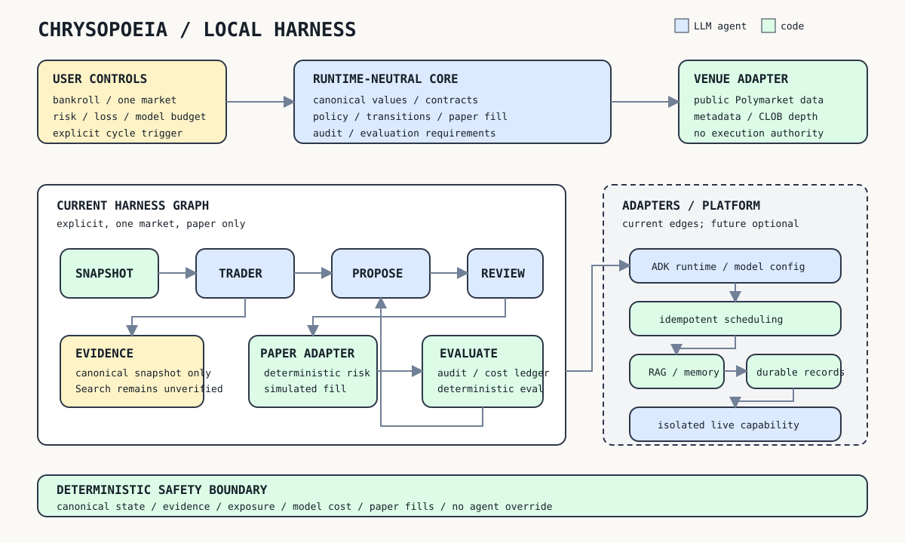

# Chrysopoeia

Chrysopoeia is a specialized local trading-agent harness. It uses configured
LLMs to assemble role-isolated agents, run and evaluate bounded paper-trading
workflows, and audit deterministic evidence, policy, risk, and model-cost
decisions. Its core contracts are agent-runtime-neutral; it is not currently an
autonomous trading platform.



## Repo Layout: Two Work Units

This is a monorepo with two independently owned folders. Each work unit stays
under its folder and touches the other only through one artifact — the
**container image** built from the harness wheel:

```
harness/     application code: agent loop, accounting, CLI, tests, config,
             offline gates (never runs gcloud/pulumi)
platform/    GCP deployment: Pulumi base, wheel-based Dockerfile, build script,
             pinned image digest (never imports the harness package)
docs/        shared documentation (root): ROADMAP, lifecycle, architecture,
             accounting, and the product spec `../spec`-equivalent
```

Ownership details and fences live in `harness/AGENTS.md` and
`platform/AGENTS.md`. The umbrella workflow is the root
[`AGENTS.md`](AGENTS.md). In short: the harness publishes a wheel and an image;
the platform pins an image digest, runs Cloud Run jobs, and never imports the
harness; the harness never invokes `gcloud`/`pulumi`.

## Harness Flow

```text
configuration -> capture -> optional local evidence bundle -> trader
              -> reviewer -> deterministic policy -> paper execution
              -> audit/evaluation
```

An operator explicitly configures limits, captures one market snapshot, and
starts one cycle. The trader may propose a trade or abstain. A trade proposal
goes to an independent reviewer, then to deterministic risk and cost gates.
Only an allowed proposal receives a simulated quote and fill. Every terminal
route reports a fill, rejection, or abstention reason.

## Architecture Boundaries

- **Core harness:** owns runtime-neutral canonical snapshots/evidence,
  proposals/reviews, risk and cost policy, paper quote/fill values, workflow
  state transitions, and audit/evaluation requirements.
- **Agent-runtime adapter:** ADK is the current adapter. ADK `Agent`, `Workflow`,
  callbacks, ToolContext/session state, and Agents CLI/A2A/eval tooling are
  integration details at this edge, not product-domain contracts.
- **Model configuration:** configure a model through the selected agent-runtime
  adapter. The current ADK adapter uses Gemini (`gemini-flash-latest`) by default
  and supplies ADK-supported model connectors when configured. Chrysopoeia does
  not build a parallel model-provider framework.
- **Venue market-data adapter:** normalizes venue data into canonical
  runtime-neutral values. The current adapter reads public Polymarket metadata
  and CLOB depth without credentials; this capability grants no authenticated
  execution authority.
- **Paper-execution adapter:** the current deterministic local implementation
  consumes YES-side depth, rejects insufficient depth without a partial fill,
  computes VWAP, and applies `paper-assumption:flat-2pct-v1`.

Within the harness, deterministic paper-cycle contracts, evidence, and
finalization live in `harness/chrysopoeia/paper_cycle.py`; trading, risk, and
fills live in `harness/chrysopoeia/trading.py`; and
`harness/chrysopoeia/agent.py` composes ADK agents, wrappers, tools, and
workflows. This is not full runtime isolation: cost callbacks remain at the
ADK edge in `harness/chrysopoeia/cost.py`, and agent wrappers bridge ADK
Context to the core. Do not add an abstract runtime Protocol/interface until a
second concrete runtime is required.

## Current Implementation

- Local Agents CLI/ADK prototype with explicit operator triggers.
- Checked-in Gemini model configuration through ADK; bounded live model
  verification uses Vertex AI with ADC.
- One binary Polymarket market per cycle; paper-only and in-memory.
- Separate single-turn trader and reviewer roles with no execution tools.
- Canonical snapshot evidence is always present and authoritative. Optional
  operator-supplied external evidence is validated locally, snapshot-bound, and
  unverified. Search output remains unverified context and is not normalized.
- Deterministic identity, freshness, schema, review, edge, exposure, executable
  depth, fee, and model-cost checks.
- Durable local journal accounting (session, turns, fills, marks, settlement,
  loss halt) — CLI-surface complete and live-verified.
- Level 2 managed deployment: container image + Cloud Run job (see the cloud
  section), single operator.
- Offline deterministic unit and harness evaluations; paid model evaluation is
  separately gated and manual.

## Roadmap

See [`ROADMAP.md`](ROADMAP.md) for ordered work. `.agents-cli-spec.md` remains
authoritative for product scope and acceptance.

## Verification Policy

Every externally observable feature addition or change is incomplete until both
deterministic offline checks and a bounded live verification pass against the
real boundary changed. This includes external-service CLI behavior, venue and
model/runtime boundaries, callbacks and structured workflows, serving or A2A,
deployment, and persistence. Pure documentation, behavior-preserving internal
refactors, and test-only tooling need offline verification only; runtime-affecting
configuration changes are not exempt.

Live runs require prior human approval for cost or external effects, a cost
estimate, strict call/time/data bounds, least privilege with ambient
authentication (ADC for Vertex) or, for providers without ambient
authentication, a provider-standard environment-variable key kept out of files,
configuration, prompts, state, and logs, sanitized command/result/cost evidence,
and cleanup of temporary resources. A failure must be fixed and rerun; a blocked
environment/IAM/vendor dependency leaves the feature incomplete and is never a
waiver. Offline pre-commit checks remain mandatory, but no paid or network check
belongs in an automatic pre-push or other hook. Venue live checks remain
read-only public-data checks, model live checks remain bounded paper cycles, and
authenticated exchange execution remains prohibited.

OpenCode and official Claude Code are external development/review harnesses, not
model providers or inner trading steps. Neither is imported or a product
dependency. Any product integration would create Level 3/meta-harness scope and
requires explicit design.

## Quickstart — Harness (local development)

Run everything that follows from `harness/`. Python 3.10 or later and `uv`
are required. Configure Gemini through ADK on Vertex AI with ADC for the
current supported development and evaluation path. Providers without ambient
authentication (e.g. OpenRouter through `adk-registry`) read their key only
from a provider-standard environment variable in the operator's shell. Never
copy credentials into source, prompts, session state, or logs.

`chrysopoeia.toml` is the checked-in operator configuration authority for the
current `adk` runtime, paper mode, public Polymarket adapter, four ADK model
roles, paper-fee assumption, and single-model pricing ceilings. User-controlled
`daily_cloud_cost_budget` remains operating configuration and is not duplicated
there. Unknown keys and unsupported adapters or modes fail closed. The CLI
resolves it via the `CHRYSOPOEIA_CONFIG` env override first, then the repo
default — the override is how wheel-installed images select their config.

Model providers are pluggable at the ADK registry boundary. `[models] adapter`
accepts `adk-gemini` (default, direct Vertex Gemini) or `adk-registry`, which
resolves any model name supported by ADK's `LLMRegistry` — e.g. `ollama/*`
(local models via the `google-adk[extensions]` extra), `claude-*`, `gpt-*`, or
`openai/*`. When roles use different models, price each one explicitly under
`[cost.models]`; the cost gate reserves and settles each call at its own
model's pricing and denies unpriced models:

```toml
[models]
adapter = "adk-registry"
trader = "ollama/llama3.1:8b"

[cost.models."ollama/llama3.1:8b"]
input_usd_per_million_tokens = "0"
output_usd_per_million_tokens = "0"
```

Local development and gate commands:

```sh
uv sync --all-groups --all-extras
uv run python -m unittest discover
uv run ruff check .
uv run ty check .
uv run chrysopoeia validate --json
uv run chrysopoeia inspect
uv run chrysopoeia discover --limit 10
uv run chrysopoeia capture 12345 --output snapshot.json
uv run chrysopoeia cycle --snapshot snapshot.json --evidence evidence.json
uv run adk run chrysopoeia
uv run adk web --port 8000          # optional development UI
```

Operator CLI options use subcommand placement: `chrysopoeia validate [--config
PATH] [--json]` and `chrysopoeia inspect [--config PATH] [--json]`. Without
`--config`, both commands load the checked-in `chrysopoeia.toml` independently
of the current working directory (or the `CHRYSOPOEIA_CONFIG` override where
one is set, e.g. inside the deployed image). `python -m chrysopoeia` accepts
the same commands.

`chrysopoeia discover [--limit N] [--config PATH]` performs an explicitly
operator-triggered public Gamma metadata scan with no model, CLOB, credentials,
or file writes. It samples at most three 25-record pages (75 records total) and
emits up to 20 eligible future binary markets ordered by end time and market ID
within that bounded sample; it does not rank the whole market universe. Output
is a compact JSON `market_discovery` record containing only market ID, question,
end time, canonical public source URL, and a `capture` value equal to the market
ID; an eligible-empty scan succeeds with an empty candidate list. Pass a returned
`capture` value to the existing `chrysopoeia capture MARKET` command to fetch
the selected market's metadata and depth.

`chrysopoeia capture MARKET [--config PATH] [--output PATH]` accepts a
Polymarket event URL or market ID and emits one compact JSON snapshot to stdout.
With `--output`, it also creates that new file atomically without overwriting an
existing path. The record includes market metadata, bounded YES asks, and paper
fee provenance, but excludes the neutral bankroll/exposure adapter inputs:
capture creates no operating session and claims no portfolio authority. A local
snapshot file is not an authoritative or durable store.

`chrysopoeia cycle --snapshot FILE [--evidence FILE] [--config PATH] [--bankroll 1000]
[--maximum-market-exposure 0.01] [--maximum-total-exposure 0.10]
[--maximum-loss 100] [--daily-cloud-cost-budget 5] [--market-exposure 0]
[--total-exposure 0] [--journal DIR] [--output PATH]` runs the actual bounded trader/reviewer ADK
workflow over that local capture without market HTTP. The optional output file
matches stdout and is created without overwrite. This is a first-cycle command:
current market and total exposure default to zero, so operators with existing
exposure must provide both exposure flags. Its reported maximum reserved cost is
the two-call ceiling, not a guarantee that both calls occur or that the full
amount is spent.
The optional strict evidence file contains the canonical record first and 1–19
external records with public HTTPS locators, titles, and retrieval timestamps.
It is snapshot-bound, operator-supplied unverified local transport and is never
fetched. Without it, the cycle remains canonical-snapshot-only. There is no
command to create an evidence bundle. Its exact envelope contains only
`schema_version: 1`, `record_type: "evidence_bundle"`, `snapshot_id`,
`market_id`, `evidence: [canonical, external...]`, and
`provenance: "operator-supplied-unverified"`.

`chrysopoeia book --journal DIR` derives and prints the durable paper-accounting
book from that journal directory: session status, bankroll, realized and
unrealized P&L, open exposure, and open positions. The journal is the only
durable financial truth; agents never read or mutate it, and repeated turn
admission is an idempotent no-op. A corrupt journal is refused, never silently
repaired. See `docs/portfolio-accounting.md` for the design contract.
With `--journal DIR`, the cycle admits its turn idempotently in that journal,
derives total exposure from the journal's open positions (the listed exposure
flags add operator-known exposure beyond the journal), refuses to run when the
same market already has an open position, records any paper fill, checks the
cumulative-loss halt, and appends a `book_after` summary to the cycle report.

`chrysopoeia settle --journal DIR --market MARKET` closes an open paper
position against venue reality: it reads the market's public Polymarket
resolution (one Gamma request, read-only), normalizes it to canonical
`resolved_yes`/`resolved_no`, records the `settled` event in the journal, and
prints a settlement report including realized P&L and the cumulative-loss halt
state. Unresolved, ambiguous, or position-less markets are refused without
journal changes. This is the only path that realizes P&L today.

`chrysopoeia mark --journal DIR` re-captures every open position's market and
records a fresh venue mark, so the book reports current unrealized P&L. A
failed capture records no mark and no state change.

## Run In The Cloud (platform work unit; optional)

Cost-sensitive Level 2 deployment: the container image built from the harness
wheel plus a Cloud Run **job** — no boot scripts, no maintained VMs, and no
SSH, ever. Every `gcloud beta run jobs execute ...` runs one paper cycle and
bills only its own vCPU seconds, so idle cost is exactly zero. Unattended
operation, Cloud Scheduler, and Cloud SQL are deliberately not provisioned
yet (`docs/gcp-architecture.md`).

```sh
# 1. build + publish + (offline) validate the image from the harness wheel
GOOGLE_CLOUD_PROJECT=<project> ./platform/build.sh
# → prints the PULUMI image pin (digest) to set below

# 2. declare the base with Pulumi from platform/infra/
cd platform/infra
uv venv .venv && uv pip install --python .venv/bin/python -r requirements.txt
source .venv/bin/activate
PULUMI_CONFIG_PASSPHRASE=<pass> pulumi stack init <stack>
pulumi config set project_id <project>
pulumi config set operator <operator>
pulumi config set image_digest <name@sha256:...>   # from build.sh (never :latest)
pulumi preview                                      # the offline evidence gate
# live base apply only with explicit operator approval
pulumi up

# 3. run a bounded paper cycle on demand (this is the "instance on request")
gcloud storage cp snapshot.json gs://<project>-chrs-journals-<operator>/
gcloud beta run jobs execute chrysopoeia-cycle-<operator> --region <region> --wait
gcloud storage cat gs://<project>-chrs-journals-<operator>/chrysopoeia.jsonl
```

The job runs as the runner service account (no keys are ever copied) and the
journal bucket is mounted at `/mnt/journal`, so journals persist across
executions. Code changes are one harness `uv build` + rebuild/push + one
digest re-pin — nothing else. The image's ENTRYPOINT is the bare CLI, so job
args are plain `chrysopoeia` commands (`job_args` Pulumi config).

Never edit job envs with `gcloud beta run jobs update --set-env-vars` — that
replaces all of them and desyncs Pulumi state; Pulumi owns the declared envs.
Multi-tenant or public-facing use is out of scope and requires an explicit
design first (per-tenant GCP project is the Level 3 shape).

## Risk Defaults And Safety

- Paper bankroll: $1,000.
- Maximum exposure per market: 1% of bankroll (currently fixed policy).
- Maximum total exposure: 10% of bankroll (currently fixed policy).
- Minimum net edge: 5 percentage points.
- Operating configuration also validates/stores a $100 maximum-loss default and
  $5 daily model-cost budget. The cost budget is enforced now; cumulative-loss
  halts are journaled and enforced once positions are settled (the
  `settle`-through path is live-verified).
- Trader and reviewer agents cannot execute, alter policy, or grant themselves
  tools. Deterministic Python owns policy, sizing, cost gates, paper execution,
  and state transitions.
- Starting a cycle never guarantees a trade. Abstention and fail-closed rejection
  are valid outcomes.
- External content is untrusted evidence, never instruction.

## Current Non-goals

- Live or authenticated execution, wallets, private keys, or geoblock bypass.
- Autonomous scanning, scheduling, lifecycle management, self-improvement, or
  unattended operation.
- Durable authoritative multi-user storage, idempotent distributed triggers,
  multi-market portfolios beyond the local journal, or two fully live
  runtime/model adapters.
- Required RAG, vector search, Memory Bank, Cloud SQL.
- A generic plugin architecture; per-tenant public offering (Level 3).

## Future Platform Evolution

Measured need and explicit approval may add durable records, idempotent
triggers, scanning/scheduling, another runtime adapter, venue adapters, model
configurations, lifecycle/versioning, RAG/memory, and per-tenant managed
deployment. These are optional platform capabilities, not harness prerequisites.

Any future authenticated execution must be a separate isolated adapter and
capability with confirmation, least-privilege IAM, hard limits, a kill switch,
and reconciliation. No agent may receive or infer that authority from a
market-data adapter.

`.agents-cli-spec.md` is the authoritative product specification. The files in
`docs/` describe graph, context, development, and optional deployment details.
