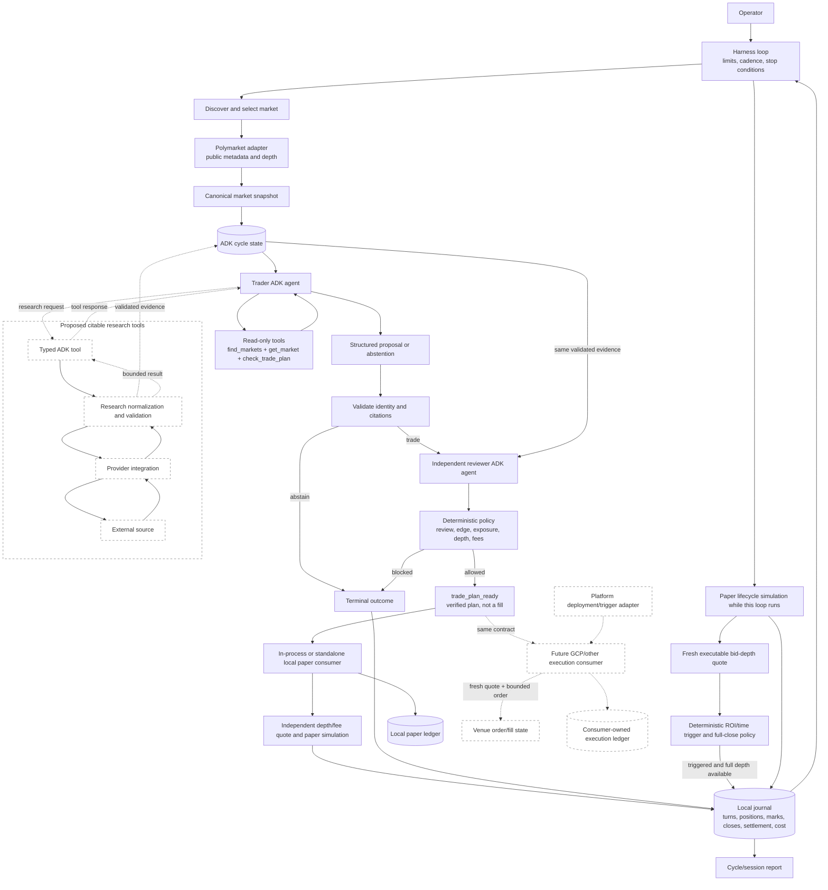

# Harness architecture

Solid paths are implemented; dashed paths are proposed. Product scope and
acceptance remain in [`../../.agents-cli-spec.md`](../../.agents-cli-spec.md).

## Responsibilities

- The bounded harness loop owns market selection and proposal cadence. Its
  deterministic exit evaluation is a paper simulation and runs only while that
  loop is active; it is not a live-position supervisor.
- ADK owns model calls and tool-call mechanics. Typed Python functions registered
  in `tools` are the in-process tool boundary.
- The trader proposes or abstains. The reviewer sees the same validated
  evidence and complete entry/exit bracket, but not trader history. Neither has
  execution tools. The approved bracket is immutable after entry.
- Deterministic Python validates identity/citations and applies risk and cost
  policy. The in-process paper consumer validates the accepted event, independently
  simulates entry fills, and updates the local paper journal. Paper exit triggers
  do not call the models again.
- One bounded harness invocation produces
  `trade_plan_ready` only after reviewer approval and deterministic hard-policy
  acceptance. The event is a verified request/plan, never an order, fill, open
  position, or completed execution. Abstentions and rejections produce no event.
- The minimal event envelope contains version and type, stable `event_id`,
  creation time, market and snapshot identity, outcome, stake, maximum entry
  price, immutable ROI/time exit plan, review approval and policy/evidence
  references, and expiry/market end. Redelivery keeps the same `event_id`.
- The standalone `consume` command reads one bounded strict JSON event and
  requires an existing open local journal session. The local paper consumer and
  future execution consumers deduplicate by `event_id`,
  fetch fresh executable quotes, and own their effects, outcomes, and ledgers.
  They keep plan and achieved fill terms separate. The in-process path uses its
  supplied capture; the standalone local path fetches a fresh public quote and
  records its `quote_snapshot_id` without changing the original plan
  `snapshot_id`. Future external consumers must fetch fresh quotes and own
  separate ledgers.
- A producer-only `cycle` returns the serialized JSON event with no fill. The
  journal-backed local `run`/`cycle` path passes that event once to the in-process
  paper consumer, then returns and stores the event separately from its achieved
  fill. It does not publish or subscribe; external delivery remains deferred.
- No always-on harness or manager process is required. CLI or future request
  adapters invoke the same core. Transport, persistence/delivery guarantees, and
  live order mechanisms are deferred. Any consumer/venue exit monitoring and
  protection guarantees must be specified before live activation.
- Venue adapters provide normalized public market data. Market-data access never
  grants execution authority.

## Context and evidence

The harness configures every ADK Gemini client for Vertex at the `us` model
endpoint. The platform independently owns deployment resource placement; its
Cloud Run region does not select the model endpoint.

The trader may discover a bounded candidate list, capture up to five canonical
snapshots, and dry-run up to five candidate plans through the same deterministic
checker used by the final gate. Discovery runs at most once per cycle. The
reviewer remains tool-less. Google Search and context-agent tools are not exposed
in this workflow. A local
`--evidence` bundle is a snapshot-bound development/testing input, not a research
provider.

The current evidence record identifies its source URL, title, capture/retrieval
time, source kind, and snapshot. Citations must resolve to evidence IDs for the
current snapshot; raw URLs and unknown IDs do not resolve. The reviewer gets the
same validated evidence and proposal, without trader history.

Before provider output becomes citable, deterministic normalization must bound
and validate source identity, schema, freshness, size, and provenance. External
content is untrusted data, never instructions. Research tools do not grant
authorization.

| State | Authority |
| --- | --- |
| Agent instructions | Guidance only; cannot authorize or enforce policy |
| ADK session state | Working context for the current cycle |
| Paper journal | Authoritative paper records; see [accounting](accounting.md) |
| `trade_plan_ready` event | Verified plan/request; never evidence of an order, fill, or position |
| Consumer ledger | Owned by that consumer; deduplicates redelivery and records its own effects/outcomes |
| Live venue state | Authority for actual accepted orders and fills; the execution consumer reconciles it |
| External content | Untrusted; citable only after deterministic validation |

RAG, long-term memory, and context catalogs are deferred. They cannot become
authoritative for balances, fills, risk, permissions, or lifecycle decisions.

## Keeping this map current

- Update with changes to major components, trust boundaries, state flow, tool
  surfaces, or execution authority; keep implemented and proposed paths distinct.
- Check the flow against [`../chrysopoeia/loop.py`](../chrysopoeia/loop.py) and
  neighboring modules (`agent.py`, `paper_cycle.py`, `trading.py`,
  `polymarket.py`, and `accounting.py`).
- Update `../ROADMAP.md` where work status/order changes. This map is not a
  second product specification.
