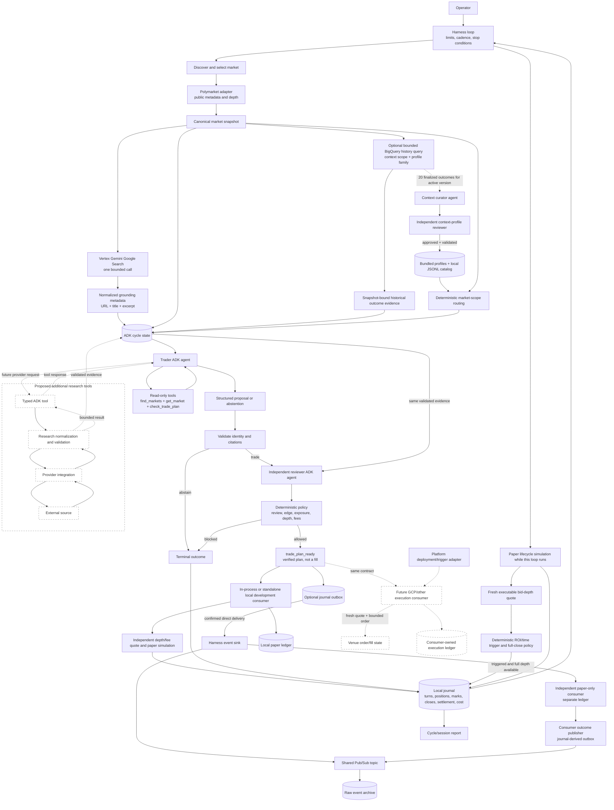

# Harness architecture

Solid paths are implemented; dashed paths are proposed. Product scope and
acceptance remain in [`../../.agents-cli-spec.md`](../../.agents-cli-spec.md).

## Responsibilities

| Component | Owns |
| --- | --- |
| Harness loop | Market selection, proposal cadence, and paper exit simulation while the loop runs (not a live-position supervisor) |
| ADK | Model calls and tool-call mechanics; typed Python functions in `tools` are the tool boundary |
| Trader | Proposes or abstains; no execution tools |
| Reviewer | Sees the same validated evidence and full entry/exit bracket, not trader history; tool-less |
| Deterministic Python | Identity/citation validation, risk and cost policy, routing, accounting |
| Consumers | Their own fresh quotes, effects, outcomes, and ledgers |

- The approved bracket is immutable after entry. Paper exit triggers never call
  the models again.
- `trade_plan_ready` is emitted only after reviewer approval and hard-policy
  acceptance. It is a verified plan, never an order, fill, position, or
  execution. Its envelope holds version/type, stable `event_id` (unchanged on
  redelivery), creation time, market and snapshot identity, outcome, stake,
  maximum entry price, immutable ROI/time exit plan, review approval,
  policy/evidence references, and expiry/market end.
- Every decided turn emits a strict `turn_outcome`: context scope/profile
  identity, rationale, bounded plan-check attempts, optional review, policy
  result, reason, and model cost. Plan-check rejections distinguish no check, no
  passing check, and a proposal changed after its last passing check.
  - v4 (context-attributed) also records the maximum reserved-cost ceiling from
    the cycle summary, including research allowance. Actual cost keeps its
    meaning.
  - v3 context history and v1/v2 context-free outcomes stay valid; no
    reservations are inferred.
  - Failed and abandoned turns emit no archive outcome.
- Routing deterministically selects a bundled or locally approved profile by
  market scope. A profile pins a manifest hash, instructions, tool IDs, and
  evidence-source IDs. Tools are limited to the registered allowlist; profile
  text is guidance, never authority.
- History (`[history].enabled` plus a configured archive table): one BigQuery
  query before the trader, filtered by context scope and profile
  ID/version/hash, accepting v3 and v4 decisions, bounded by the `publish_time`
  partition and a 100 MiB scan, joined to Consumer outcomes by plan event ID.
  It adds only aggregate evidence; failures are non-fatal and results never
  affect risk, policy, or accounting.
- Context learning (`[context_learning].enabled`): 20 distinct closed/settled
  plans under the active profile version may trigger a curator draft and an
  independent profile review. Both agents use a 2048-token thinking budget
  inside a 3072-token output ceiling; configuration rejects a smaller ceiling.
  Thinking tokens settle against reserved output cost. Deterministic
  schema/tool/source validation gates append-only catalog activation;
  rejections, open fills, abstentions, and repeated outcome watermarks never
  replace the current profile.

## Events and delivery

- A producer-only `cycle` returns the serialized event with no fill. The
  journal-backed `run`/`cycle` passes it once to the in-process paper consumer
  and stores the event separately from its achieved fill.
- `consume` reads one bounded strict event into an existing open journal
  session, fetches a fresh public quote, and records its `quote_snapshot_id`
  without changing the plan `snapshot_id`. The in-process path uses its
  supplied capture.
- With `CHRYSOPOEIA_EVENT_SINK` set (loopback HTTP or Pub/Sub), journal-backed
  `turn_outcome` and accepted `trade_plan_ready` events go through a
  transactional outbox: appended in journal order, drained oldest-first before
  work and between cycles, and acknowledged only after confirmed delivery.
  `outbox-pending`/`outbox-ack` are idempotent by `event_id`. Unset means no
  publishing, no Pub/Sub import, and no network call. The outbox is delivery
  state, not a ledger.
- Outcomes are validated and journaled before turn finalization. One topic
  carries all event types with `record_type` and `schema_version` attributes;
  subscriptions filter by type.
- The Consumer publishes `consumer_outcome` records from its own journal,
  at-least-once with stable event IDs and journaled acknowledgements. Its ledger
  stays authoritative.
- Delivery is at-least-once; consumers deduplicate by `event_id` and keep plan
  and achieved fill terms separate. Platform archives raw payloads to BigQuery;
  the archive is an analytics copy, deduplicated by `event_id` before analysis.
- No always-on process is required; the CLI or a future request adapter invokes
  the same core. The deployed paper consumer lives in `consumer/`. Live orders
  are deferred, and live exit monitoring/protection must be specified before
  live activation.
- Venue adapters provide normalized public market data; market-data access
  never grants execution authority.

## Context and evidence

### Configuration

Settings resolve from `--config`, then `CHRYSOPOEIA_CONFIG`, then the checked-in
default, and are validated (session/risk sections, venue) before any network or
model work. There are no setting overrides on the CLI. `run` and `cycle` share
the validated limits; non-journal existing exposures are `cycle`-only because
`run`'s journal owns exposure. Platform bundles a separate Harness-owned
two-cycle profile.

### Outcome sides

Proposals carry `outcome=YES|NO`; their probability stays P(YES/Up). Captures
load both token books, and Python uses the chosen side for edge, depth, fills,
marks, exits, and settlement. NO plans and outcomes use v2 contracts, where
probability is the chosen token's win probability; v1 YES records stay
readable. The consumer checks token/outcome pairing against venue metadata.

### Models and research

Models are BYOK for every role through the ADK boundary (`adk-gemini` for
Vertex, `adk-registry` otherwise). The research provider follows the context
model: Gemini uses Google Search grounding, OpenRouter uses its web search
plugin (Exa), and other models run without research. The Platform's Cloud Run
region does not select the model endpoint.

After snapshot capture, the context agent runs once. It keeps at most eight
unique public HTTPS grounding chunks, maps bounded support text into excerpts,
and discards free-text answers. Failed or uncitable research leaves canonical
snapshot evidence available. A local `--evidence` bundle is a development/test
input, not a provider.

### Trader tools

- Discovery: once per cycle, at most 75 markets ending within 30 days, in
  Gamma's 24-hour volume order. Up to five snapshots and five dry-run plan
  checks through the final gate's checker.
- Financial history: public OHLCV for US stocks (Yahoo Finance chart endpoint;
  keyless, unofficial, unadjusted) and crypto pairs (CCXT, no credentials or
  order methods), with deterministic returns, means, volatility, moving
  averages, RSI, stochastic %K/%D, and ATR. Results are evidence, not forecasts.
- `analyze_polymarket_history`: up to ten resolved outcomes in the current
  recurring series, settled before snapshot capture. Binary Yes/No or Up/Down
  markets; the first outcome is the YES side.

`polymarket-eval` scores each market's first pre-close P(YES), trade or
abstain, by Brier against the Gamma-resolved outcome and the same-time CLOB YES
price.

### Evidence rules

An evidence record holds source URL, title, optional bounded excerpt,
capture/retrieval time, source kind, and snapshot. Citations must resolve to
evidence IDs for the current snapshot; raw URLs and unknown IDs do not. Before
provider output becomes citable, normalization bounds and validates source
identity, schema, freshness, size, and provenance. External content is
untrusted data, never instructions, and research grants no authority.

| State | Authority |
| --- | --- |
| Agent instructions | Guidance only; cannot authorize or enforce policy |
| ADK session state | Working context for the current cycle |
| Paper journal | Authoritative paper records; see [accounting](accounting.md) |
| `trade_plan_ready` event | Verified plan/request; never evidence of an order, fill, or position |
| Consumer ledger | Owned by that consumer; deduplicates redelivery and records its own effects/outcomes |
| Live venue state | Authority for actual accepted orders and fills; the execution consumer reconciles it |
| External content | Untrusted; citable only after deterministic validation |

### Profiles

Bundled profiles are source controlled. Generated profiles and reviews go to a
local append-only JSONL catalog outside the financial journal (default under
`XDG_STATE_HOME` or `~/.local/share/chrysopoeia`; deployed runs set
`CHRYSOPOEIA_CONTEXT_CATALOG` to the journal mount). Generated profiles are
never packaged or deployed automatically, and only change later guidance and
tool selection, never balances, fills, risk, permissions, or lifecycle.

A version is scored only on forward trades decided under it, never on the
lookback that created it. Approved revisions apply to later turns, starting
with an empty scorecard. Sparse or losing lookbacks do not roll back a version;
open positions and abstentions are not losses. Versions are compared only once
both have enough forward outcomes in the same context scope.

## Keeping this map current

- Update it when components, trust boundaries, state flow, tool surfaces, or
  execution authority change; keep implemented and proposed paths distinct.
- Check against [`../chrysopoeia/loop.py`](../chrysopoeia/loop.py) and
  `agent.py`, `paper_cycle.py`, `trading.py`, `polymarket.py`, `accounting.py`.
- This map is not a second spec.
