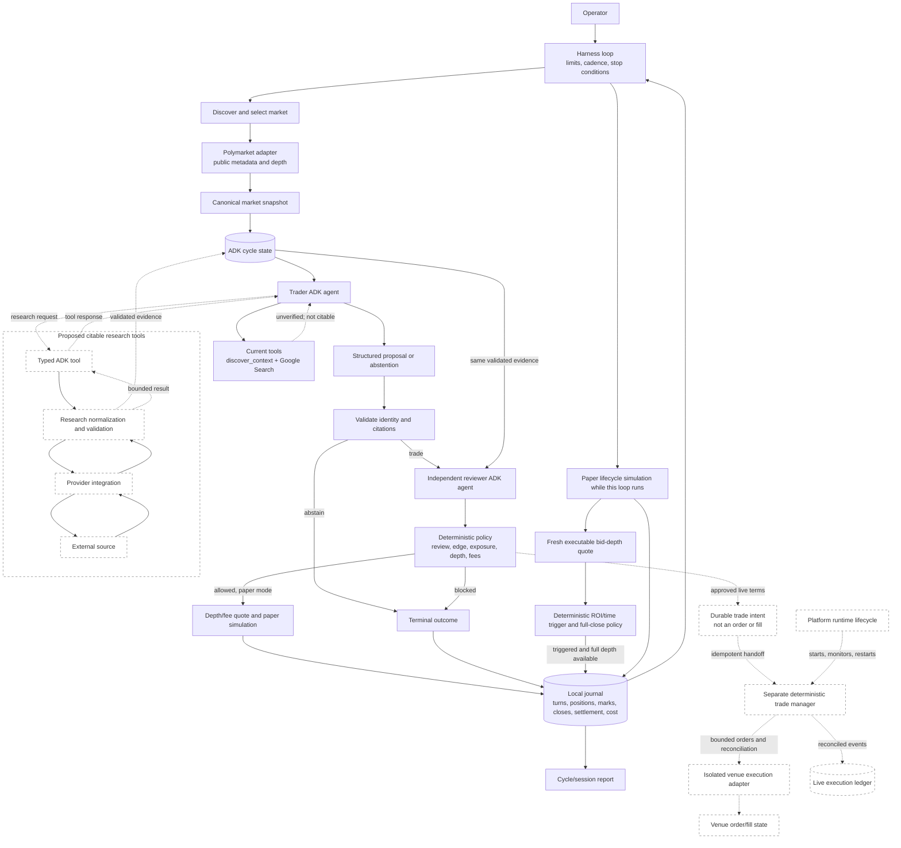

# Harness architecture

Solid paths are implemented; dashed paths are proposed. Product scope and
acceptance remain in [`../../.agents-cli-spec.md`](../../.agents-cli-spec.md).

## Responsibilities

- The bounded harness loop owns market selection and proposal cadence. Its
  deterministic exit evaluation is a paper simulation and runs only while that
  loop is active; it is not a live-position supervisor.
- ADK owns model calls and tool-call mechanics. Typed Python functions registered
  in `tools` are the in-process tool boundary.
- The trader proposes or abstains. The reviewer sees the same validated
  evidence and complete entry/exit bracket, but not trader history. Neither has
  execution tools. The approved bracket is immutable after entry.
- Deterministic Python validates identity/citations, applies risk and cost
  policy, simulates paper entry fills and exits, updates the paper journal, and
  decides terminal outcomes. Paper exit triggers do not call the models again.
- In live mode the harness records a durable, approved trade intent. A separate
  deterministic manager consumes it and owns actual order submission, position
  monitoring, restart recovery, and venue reconciliation. It has no model calls.
  Its policy and adapter code can ship in the harness wheel, but it runs as a
  separate process/entrypoint from ADK. The platform owns that process's
  lifecycle; the on-demand Cloud Run Job is not an always-on manager.
- Venue adapters provide normalized public market data. Market-data access never
  grants execution authority.

## Context and evidence

The trader receives a normalized snapshot and canonical evidence. Google Search
is available as unverified context but cannot currently be cited. A local
`--evidence` bundle is a snapshot-bound development/testing input, not a research
provider.

The current evidence record identifies its source URL, title, capture/retrieval
time, source kind, and snapshot. Citations must resolve to evidence IDs for the
current snapshot; raw URLs and unknown IDs do not resolve. The reviewer gets the
same validated evidence and proposal, without trader history.

Before provider output becomes citable, deterministic normalization must bound
and validate source identity, schema, freshness, size, and provenance. External
content is untrusted data, never instructions. Research tools do not grant
authorization.

| State | Authority |
| --- | --- |
| Agent instructions | Guidance only; cannot authorize or enforce policy |
| ADK session state | Working context for the current cycle |
| Paper journal | Authoritative paper records; see [accounting](accounting.md) |
| Live intent | Durable request for execution; never evidence that an order filled |
| Live venue state | Authority for actual accepted orders and fills; manager reconciles it into the live ledger |
| External content | Untrusted; citable only after deterministic validation |

RAG, long-term memory, and context catalogs are deferred. They cannot become
authoritative for balances, fills, risk, permissions, or lifecycle decisions.

## Keeping this map current

- Update with changes to major components, trust boundaries, state flow, tool
  surfaces, or execution authority; keep implemented and proposed paths distinct.
- Check the flow against [`../chrysopoeia/loop.py`](../chrysopoeia/loop.py) and
  neighboring modules (`agent.py`, `paper_cycle.py`, `trading.py`,
  `polymarket.py`, and `accounting.py`).
- Update `../ROADMAP.md` where work status/order changes. This map is not a
  second product specification.
